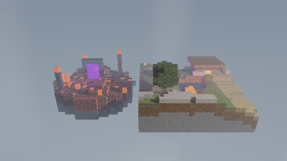

# Diorama voxel — Ray Tracing en Rust

Ray tracer escrito desde cero en Rust con una ventana interactiva de Raylib. La imagen se calcula completamente en CPU: una isla natural con lago, cascada y cabaña, más una isla volcánica Nether con lava, magma, pilares y un portal violeta emisivo.



## Video

[Ver recorrido completo del diorama](docs/demo.mp4)

## Ejecutar

Se necesita Rust estable. La única dependencia es Raylib para crear la ventana, recibir el teclado/ratón y mostrar el búfer de píxeles. Raylib no calcula el ray tracing.

```bash
cargo run --release
```

### Controles

- `A`/`D` o flechas izquierda/derecha: rotar el diorama.
- `W`/`S`, flechas arriba/abajo o rueda: acercar y alejar (hasta 10 unidades de distancia).
- Arrastrar con el botón izquierdo: rotar con el ratón.
- `R`: restaurar la cámara.
- `Esc`: cerrar.

La resolución interna predeterminada es 560×315 y se escala a la ventana. Es un aumento moderado de nitidez sin elevar demasiado el costo. Puede reducirse en computadoras lentas:

```bash
cargo run --release -- --width 320 --height 180
```

## Texturas de bloques

El ray tracer carga las imágenes de `assets/textures/` una sola vez y las muestrea directamente en CPU. Césped y madera pueden usar imágenes diferentes en la tapa y en los laterales. Si falta un archivo, utiliza automáticamente la textura procedural correspondiente para que la escena siga funcionando.

| Bloque | Archivo esperado | Búsqueda sugerida |
|---|---|---|
| Césped superior | `grass_top.png` | `grass block top seamless texture 16x16` |
| Lateral de césped | `grass_side.png` | `grass block side seamless texture 16x16` |
| Tierra | `dirt.png` | `dirt block seamless texture 16x16` |
| Piedra | `stone.png` | `stone block seamless texture 16x16` |
| Tronco lateral | `wood_side.png` | `oak log side seamless texture 16x16` |
| Tronco superior | `wood_top.png` | `oak log top seamless texture 16x16` |
| Hojas | `leaves.png` | `oak leaves seamless texture 16x16` |
| Agua | `water.png` | `water block seamless texture 16x16` |
| Cristal | `glass.png` | `glass block seamless texture 16x16` |
| Lava | `lava.png` | `lava block seamless texture 16x16` |
| Glowstone | `glowstone.png` | `glowstone seamless texture 16x16` |
| Nieve | `snow.png` | `snow block seamless texture 16x16` |
| Arena | `sand.png` | `sand block seamless texture 16x16` |

Conviene descargar imágenes cuadradas, sin perspectiva y repetibles (*seamless*), preferiblemente PNG de 16×16, 32×32 o 64×64. Deben ser propias, libres o tener una licencia que permita utilizarlas; no se incluyen archivos originales de Minecraft.

Actualmente se cargan imágenes para césped, piedra, madera lateral, hojas, agua, cristal, lava y glowstone. Tierra, nieve, arena y la tapa de madera conservan su alternativa procedural mientras no exista el PNG correspondiente.

Generar 120 cuadros para el video (órbita completa con zoom suave):

```bash
cargo run --release -- --headless --width 640 --height 360 --frames 120 --output renders
```

Los BMP se pueden importar como secuencia en un editor. Con FFmpeg, este comando crea el archivo esperado por el README:

```bash
ffmpeg -framerate 30 -i renders/frame_%04d.bmp -c:v libx264 -pix_fmt yuv420p docs/demo.mp4
```

Para ver todas las opciones: `cargo run --release -- --help`.

## Características evaluadas

| Rúbrica | Implementación visible |
|---|---|
| Escena compleja y atractiva | Isla montañosa, lago, cascada, cabaña, árbol, arco de cristal, grieta de lava, iluminación cálida y neblina |
| Paralelismo y optimización | Filas repartidas entre núcleos con `std::thread`; recorrido DDA Amanatides–Woo; mundo contiguo; LTO |
| Rotación y zoom | Controles interactivos de teclado, rueda y ratón; la animación offline completa 360° con zoom sinusoidal |
| Cinco materiales o más | Césped, tierra, piedra, madera, hojas, agua, cristal, lava, glowstone, nieve y arena; cada uno tiene textura y parámetros propios |
| Refracción | Agua (IOR 1.333) y cristal (IOR 1.5), con reflexión total interna |
| Reflexión | Reflejos recursivos y Fresnel en agua, cristal, piedra y nieve |
| Mapas normales | Cuatro mapas PNG reales (`stone`, `water`, `netherrack`, `obsidian`) transformados mediante una base TBN; los demás materiales tienen fallback procedural |
| Material emisivo | Lava y ventanas de glowstone; luces locales acentúan su efecto |
| Skybox | Cubemap real de seis imágenes PNG (`±X`, `±Y`, `±Z`), muestreado por dirección y visible en rayos primarios, reflejos y refracciones |
| Terreno procedural | Mundo de 46×16×24 con una isla natural y otra volcánica, generadas mediante value noise determinista |

## Arquitectura

- `src/math.rs`: vectores, reflexión, refracción, hash y ruido procedural.
- `src/material.rs`: once materiales, parámetros y texturas.
- `src/world.rs`: generación del diorama e intersección DDA.
- `src/renderer.rs`: cámara, ray tracing, luces, sombras, skybox, paralelismo y exportación.
- `src/main.rs`: ventana Raylib, controles, interfaz de línea de comandos y animación.
- `assets/skybox/`: seis caras del cubemap cargadas como imágenes.
- `tools/generate_render_assets.ps1`: generación reproducible de normal maps y caras del skybox.

La imagen usa tone mapping de Reinhard y corrección gamma. Los rayos secundarios llevan un sesgo para evitar *shadow acne*. La profundidad predeterminada es tres y se cambia con `--bounces`.

## Verificación

```bash
cargo test
cargo clippy -- -D warnings
```

## Restricciones

- Raylib es la única dependencia y se usa para ventana, entrada y presentación.
- Sin shaders de ray tracing, CUDA ni cómputo de geometría en GPU.
- Geometría, intersecciones, iluminación, texturas y efectos calculados en CPU.
